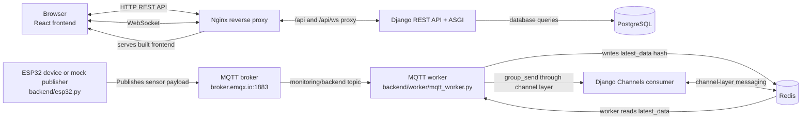

# Monitoring IoT Web

Monitoring IoT Web is a full-stack web application for monitoring IoT sensor data and controlling actuators through a browser-based dashboard. It combines React, Django, MQTT, Redis, and WebSocket communication for device management and real-time sensor updates.

## Overview

The application provides a centralized interface for viewing sensor readings, managing IoT devices, and controlling actuators. An IoT device or the mock ESP32 publisher sends sensor payloads to an MQTT broker. A Python worker subscribes to `monitoring/backend`, stores the latest values in Redis, and periodically reads them back before sending events through the Redis-backed Django Channels layer. The React frontend receives these events over WebSocket.

The application is intended for operators or administrators who need to view sensor values, inspect device status, manage devices, and toggle actuators. Authentication includes email/password login, registration, email verification, password reset, and Google OAuth sign-in; these flows depend on valid email and OAuth configuration.

## Features

### Real-time sensor monitoring
- Sensor cards display the device name and ID, latest reading, and measurement unit. Device Settings shows configured maximum values, thresholds, status, and chart type.
- A WebSocket connection pushes latest sensor payloads to the browser so values refresh without a full page reload.
- The frontend renders line, doughnut, and bar charts using Chart.js. The line chart is derived from the current reading rather than historical readings; the dashboard summary chart uses generated random values.
- The MQTT worker stores only the latest values in Redis. Its sensor-reading database write is commented out, so persistent sensor history is not implemented in this data flow.

### Device management
- Devices use the `Device` model with `idDevice`, `name`, and `type` fields, with related sensor and actuator models.
- The device API lists and filters devices by `type`, `status`, and `search`; the UI provides device creation and status controls.
- The combined serializer returns device details together with available sensor or actuator settings.
- These are partial management operations, not complete CRUD support for every device field.

### Actuator control
- Actuator status can be switched on or off from its device card in Device Settings. The separate dashboard control panel's toggle callback is not connected.
- Actuator data includes status, activation mode, target sensor, activation value, comparison, and last activation timestamp.
- The model and UI include configuration fields for manual and sensor-based activation, but the source does not demonstrate a complete autonomous control loop using sensor values.

### Authentication and authorization
- Manual login, logout, registration, and password change/reset endpoints are present in the Django authentication app.
- Email verification is configured through the auth adapter and SMTP email backend.
- Google OAuth login is implemented using `django-allauth` and `dj_rest_auth`.
- JWT-based authentication uses cookie-based token handling for API requests.

### API integration
- The backend exposes REST endpoints for device listing, creation, and filtering.
- The API is documented with `drf-spectacular` and rendered through Swagger UI and Redoc endpoints.
- Frontend requests use Axios with credentialed cookies and CSRF token handling.

### IoT communication
- A mock ESP32 script publishes synthetic sensor data to an MQTT broker using `paho-mqtt`.
- The backend MQTT worker subscribes to `monitoring/backend`, writes sensor values to Redis, and polls Redis for the latest values.
- The worker sends group events through the Redis-backed Django Channels layer, which delivers them to connected frontend WebSocket clients.

## Technology Stack

### Frontend
- React 19 (declared as `^19.2.0` in `frontend/package.json`)
- Vite
- React Router DOM
- Axios
- Chart.js and `react-chartjs-2`
- `js-cookie` for cookie handling
- Tailwind CSS tooling in the frontend build

### Backend
- Django 6.0.2
- Django REST Framework
- `dj-rest-auth`
- `djangorestframework-simplejwt`
- `django-allauth`
- Django Channels
- `drf-spectacular`

### Database
- PostgreSQL is configured in `backend/core/settings.py` with the `psycopg2-binary` driver.
- A SQLite file is present in the repository, but the active Django configuration points to PostgreSQL.

### Real-time communication
- Redis for latest-data storage and broadcast coordination
- WebSocket via Django Channels
- MQTT via `paho-mqtt`

### IoT integration and infrastructure
- ESP32 mock publisher script: `backend/esp32.py`
- MQTT worker: `backend/worker/mqtt_worker.py`
- Docker Compose orchestration
- Nginx reverse proxy configuration

## System Architecture

1. The ESP32 device or mock publisher sends sensor payloads to the MQTT broker; the worker receives messages from `monitoring/backend`.
2. The worker updates the Redis `latest_data` hash and periodically reads its latest values.
3. The worker sends group events through Django Channels' Redis-backed channel layer. The Channels consumer delivers events over `/api/ws/websocket-server/`.
4. The React frontend uses WebSocket for live sensor updates and REST API requests for device and account operations. Django uses PostgreSQL for application records.

In the configured container deployment, Nginx serves the built frontend and proxies `/api/` and WebSocket requests to Django. The frontend constructs a `wss://` URL from the current host, so the WebSocket flow requires a TLS-enabled host or compatible proxy configuration.

## API Documentation

### Device endpoints

| Method | Endpoint | Purpose | Authentication |
|---|---|---|---|
| GET | `/device/` | List devices; accepts `type`, `status` (`on` or `off`), and `search` query parameters | No endpoint permission is set; DRF defaults to `AllowAny` |
| POST | `/device/` | Create a device when `post` is `new`, or change sensor/actuator status when `post` is `statusUpdate` | No endpoint permission is set; DRF defaults to `AllowAny` |
| PATCH | `/device/` | Parses the request body but does not perform an update or return a response; incomplete | No endpoint permission is set; DRF defaults to `AllowAny` |
| GET | `/device/<type>/` | List devices for the requested type | No authentication check is implemented in this Django view |

Routes in these tables are relative to Django's URL configuration. In the configured Nginx deployment, the browser uses the `/api/` prefix, for example `/api/device/`.

### Authentication endpoints

| Method | Endpoint | Purpose | Authentication |
|---|---|---|---|
| GET, PATCH | `/authenticate/user/` | Read user details and submit profile updates (these are the methods used by the frontend) | Defined by the imported `dj-rest-auth` view; not configured in this repository |
| POST | `/authenticate/google/` | Google OAuth login through `SocialLoginView` | Defined by the imported `dj-rest-auth` view; not configured in this repository |
| POST | `/authenticate/login/` | Email/password login through `LoginView` | Defined by the imported `dj-rest-auth` view; not configured in this repository |
| POST | `/authenticate/logout/` | Log out through `LogoutView` | Defined by the imported `dj-rest-auth` view; not configured in this repository |
| POST | `/authenticate/register/` | Register a new user through `RegisterView` | Defined by the imported `dj-rest-auth` view; not configured in this repository |
| POST | `/authenticate/register/verify-email/` | Verify email through `VerifyEmailView` | Defined by the imported `dj-rest-auth` view; not configured in this repository |
| POST | `/authenticate/register/resend-email/` | Resend verification email through `ResendEmailVerificationView` | Defined by the imported `dj-rest-auth` view; not configured in this repository |
| POST | `/authenticate/password/change/` | Change password through `PasswordChangeView` | Defined by the imported `dj-rest-auth` view; not configured in this repository |
| POST | `/authenticate/password/reset/` | Request a password reset through `PasswordResetView` | Defined by the imported `dj-rest-auth` view; not configured in this repository |
| POST | `/authenticate/password/reset/confirm/` | Confirm password reset through `PasswordResetConfirmView` | Defined by the imported `dj-rest-auth` view; not configured in this repository |
| POST | `/authenticate/token/verify/` | Verify a JWT through SimpleJWT's `TokenVerifyView` | Defined by the imported SimpleJWT view; not configured in this repository |
| POST | `/authenticate/token/refresh/` | Refresh a JWT through `dj-rest-auth`'s refresh view | Defined by the imported `dj-rest-auth` view; not configured in this repository |

The authentication views are imported from installed packages rather than implemented locally. Their endpoint-specific permission classes are not declared in this repository, so their authentication requirements cannot be confirmed from checked-in source. In the configured Nginx deployment, these routes use the `/api/` prefix, such as `/api/authenticate/login/`.

### OpenAPI documentation endpoints

| Method | Endpoint | Purpose | Authentication |
|---|---|---|---|
| GET | `/schema/` | Return the OpenAPI schema | No project permission override is configured |
| GET | `/docs/` | Swagger UI documentation | No project permission override is configured |
| GET | `/redoc/` | ReDoc API documentation | No project permission override is configured |

In the configured Nginx deployment, these documentation URLs use the `/api/` prefix, such as `/api/docs/`.

## Usage Guide

### Logging in and registering
- Open the login page and sign in with an existing email/password account.
- New users can register and complete email verification; the email service must be configured.
- Google Sign-In is available when OAuth credentials and the site URL are configured.
- Unauthenticated users who visit protected frontend pages are redirected to `/login`.

### Viewing sensor data
- Sign in to access the dashboard and review the sensor cards.
- Cards show the device name, ID, latest reading, unit, and chart. Device Settings shows configured thresholds, maximum values, device status, and chart type.
- Observe the dashboard for WebSocket updates as MQTT data arrives. This requires the publisher, worker, Redis, Channels, and a compatible TLS/WebSocket proxy to be available.
- The live line chart is derived from the current reading, not historical sensor records. The dashboard summary chart uses generated random values.

### Searching, filtering, and managing devices
- Open Device Settings and filter by device type or status, or search by device name.
- Use the form to create a sensor or actuator device.
- Use a device card control to change its status; the frontend submits the change to the device API.
- Management is limited to implemented operations; the device API does not provide full CRUD for every field, and its PATCH handler is incomplete.

### Controlling actuators
- Open Device Settings, find an actuator card, and switch its status on or off.
- Manual switching is the implemented control action. Sensor-based activation fields exist, but the application does not demonstrate an autonomous control loop using them.

### Using real-time monitoring
- Ensure the publisher sends messages to the configured MQTT broker and `monitoring/backend` topic.
- Ensure the MQTT worker, Redis, and Django Channels are available.
- Open the dashboard through a TLS-enabled host or compatible reverse proxy. The frontend connects to `wss://<current-host>/api/ws/websocket-server/`.
- New payloads update the latest sensor values shown in the dashboard; the current pipeline does not provide persistent sensor history.
